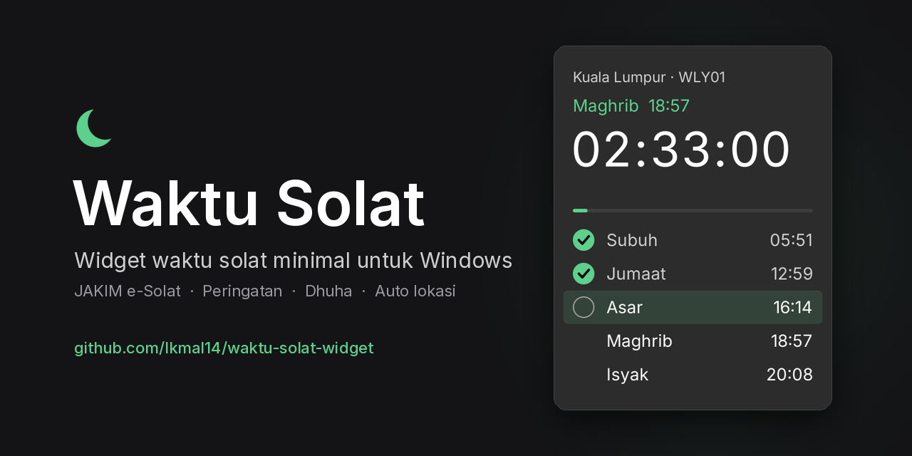

# Waktu Solat



A minimal Malaysian prayer-times widget for Windows 10/11.

- One small `.exe`, about 200 KB. No install, no admin rights, no Python. It uses .NET Framework 4.8, which is already part of Windows.
- **Official JAKIM e-Solat times** for every zone. It downloads a whole year at once and caches it, so it keeps working offline.

## Download
Get `WaktuSolat.exe` from [Releases](../../releases/latest). Put it somewhere permanent, e.g. `Documents\WaktuSolat\`, and run it. If SmartScreen appears: **More info → Run anyway** (the exe isn't code-signed).

**"Windows protected your PC" (SmartScreen)** appears once, on the first browser download, because the exe isn't code-signed and is new. Either:
- click **More info → Run anyway**, or
- before running: right-click `WaktuSolat.exe` → **Properties** → tick **Unblock** → **OK**.

Updates installed by the app itself don't show this warning. On a managed work laptop, follow your IT policy; if *Run anyway* is missing, IT has blocked unrecognised apps.

**Verify the download** (optional):
- Every release is built from this source by GitHub Actions and carries a signed build-provenance attestation. Check it with `gh attestation verify WaktuSolat.exe --repo Ikmal14/waktu-solat-widget`.
- The SHA-256 is listed on each release page.

## What it does

**Widget**
- A countdown to the next waktu.
- Today's five waktu, with the current one highlighted.
- Click the circle next to a waktu to tick it **✓ dah solat**.
- Resizable: drag any edge. Make it wide and it becomes a horizontal bar.

**Popups**, using Windows' own notification sounds:
- **Masuk waktu:** when each waktu begins.
- **Peringatan:** 30 minutes before the **current** waktu ends, unless you've ticked it. Subuh ends at Syuruk, Zohor at Asar, Asar at Maghrib, Maghrib at Isyak, and Isyak at the next Subuh.
- **Dhuha:** a small notice when Dhuha starts, and another before it ends.

**How the popups behave**
- They never steal focus.
- They're held back while you're presenting or running a fullscreen app.
- They still show when Windows notifications are disabled by IT.

**Location and settings**
- **Auto zone** from Windows Location, matched to a JAKIM zone on your PC.
- **Tema:** follow Windows, Gelap or Terang, plus 5 accent colours.
- **Starts with Windows**; turn it off in the menu.
- **Updates:**
  - The app checks once a week; *Kemas kini → Semak sekarang* checks right away.
  - Clicking **"Versi X tersedia"** downloads the new exe from this repo's release, verifies it, swaps it in, restarts, and **removes the old version**.
  - The verification: the file's size and SHA-256 must match GitHub's published digest, and it must identify itself as Waktu Solat at exactly that version.
  - Nothing is installed without your click.

Right-click the widget or the tray icon for the menu: Zon, Peringatan, Bunyi, Tema, Susun atur, and so on. The location and hide buttons appear when you hover over the widget.

If the footer says **"≈ Anggaran"**, JAKIM data couldn't be downloaded yet and the times are calculated. Don't rely on those for Subuh. The menu shows the reason.

## Security & privacy
- **Network:** HTTPS only, to:
  - `e-solat.gov.my` for prayer times.
  - `api.github.com`, once a week, to read this repo's latest release (can be turned off).
  - When you click an update: `github.com/Ikmal14/waktu-solat-widget/releases/download/…` and GitHub's release storage, `release-assets.githubusercontent.com`.
- **Connections:** certificates are always checked, redirects are re-checked against the allow-list, and responses are size- and time-limited and validated.
- **Location:** read through Windows, matched to a zone in memory, then discarded. Only the zone code is saved.
- **Files:** `%APPDATA%\WaktuSolat\` (settings, cache, ticks), plus the exe's own folder during an update. The only registry write is `HKCU\…\Run\WaktuSolat`, for autostart.
- **No tracking:** no telemetry, no accounts, no tokens, no admin rights.

## How Dhuha is timed
- **Start = Syuruk + 25 minutes.** This comes from Pejabat Mufti Wilayah Persekutuan's timetables, which cite JAKIM's Almanak Falak Syarie: *"Awal waktu Dhuha: 25 minit selepas waktu Syuruk"*. Syuruk to Dhuha is *waktu tahrim* (Mufti Perak). Perak's own timetables use about 15 minutes.
- **End = 10 minutes before Zohor.** Dhuha ends at istiwa', just before Zohor. No official Malaysian minute figure was found. A Jabatan Mufti Selangor (JUFFAS) study measured istiwa' at about 1–2 minutes, so the 10 minutes is a **precaution, not an official JAKIM figure**.

## Design
The design follows Windows 11 (Fluent) guidance:
- The type ramp: Caption 12, Body 14, Title Large 40.
- A 4 px spacing grid.
- WinUI surface and text colours.
- Accent used sparingly.
- WCAG 2.2 AA contrast for every theme.
- Fluent motion timings, respecting the Windows "animation effects" setting.

## Credits
- Prayer times: [JAKIM e-Solat](https://www.e-solat.gov.my).
- Zone boundaries: [mptwaktusolat/malaysia.geojson](https://github.com/mptwaktusolat/malaysia.geojson). These are district polygons with JAKIM codes, simplified to about 200 m. Kinta, Kerian and Hilir Perak were corrected to JAKIM's zone list. The source repository has no licence file; credit is given here, and the data will be removed on request.
- Six special zones can't be detected from district boundaries; pick them in the menu. They are Gunung Jerai, Bukit Tinggi, Rompin (PHG07), Bukit Larut, Gunung Kinabalu and Kg Patarikan.

## Build
```
dotnet build -c Release          # → bin/Release/net48/WaktuSolat.exe
cd tests && dotnet run -c Release
```

## Releasing an update
Bump `<Version>` in `WaktuSolat.csproj` (e.g. `5.0.1`) and push to `main`. GitHub Actions builds the exe on Windows, runs the tests and publishes release `v5.0.1`. Installed widgets (v5.1+) notice it at their next weekly check and update themselves when you click the notice.
